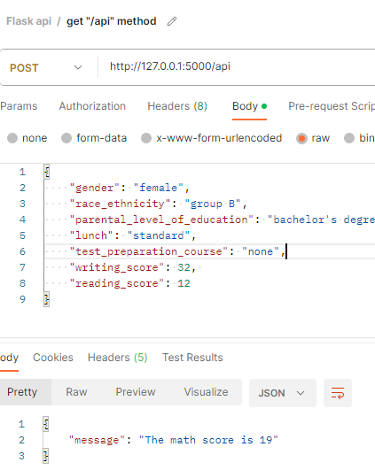

# Student Performance Indicator

This project implements a machine learning pipeline to predict student performance based on various features. It includes data ingestion, transformation, model training, and a Flask web application for predictions.

## 🛠️ Setup Environment

### 1. Create a Virtual Environment
```bash
python3 -m venv venv
source venv/bin/activate  # On Windows use `venv\Scripts\activate`
```

### 2. Install Dependencies
You can install the package and its dependencies using `pip`:

```bash
pip install -e .
```

> **Note:** The method `python setup.py install` is deprecated. Please use `pip install .` instead.

## 🚀 Usage

### Training the Model
To train the model, run the data ingestion script:

```bash
python src/components/data_ingestion.py
```

### Running the Web App
To start the Flask application:

```bash
python app.py
```
Access the application at `http://127.0.0.1:5000/`.

## 📂 Project Structure

```
ml_project/
├── src/
│   ├── components/
│   │   ├── data_ingestion.py
│   │   ├── data_transformation.py
│   │   └── model_train.py
│   ├── pipeline/
│   │   ├── predict_pipeline.py
│   ├── utils.py
│   ├── logger.py
│   └── exception.py
├── app.py
├── setup.py
├── requirements.txt
└── README.md
```

## 🧠 Ensemble Techniques

### `AdaBoostRegressor` and `GradientBoostingRegressor`

1.  **Algorithm:**
    *   `AdaBoostRegressor` uses the AdaBoost algorithm, combining multiple weak learners sequentially. It weights misclassified instances higher to focus on them.
    *   `GradientBoostingRegressor` uses gradient boosting, fitting subsequent models to the residuals of previous ones to minimize the loss function.

2.  **Loss Function:**
    *   `AdaBoostRegressor` minimizes the exponential loss function.
    *   `GradientBoostingRegressor` supports various loss functions (least squares, absolute deviation, huber).

3.  **Weighting of Weak Learners:**
    *   `AdaBoostRegressor` weights learners based on performance (lower error = higher weight).
    *   `GradientBoostingRegressor` weights learners based on gradient descent steps.

4.  **Model Complexity:**
    *   `AdaBoostRegressor` typically uses simple decision stumps.
    *   `GradientBoostingRegressor` can use deeper trees.

5.  **Hyperparameters:**
    *   Both share parameters like `n_estimators` but have specific ones (e.g., `loss` for AdaBoost, `subsample` for Gradient Boosting).

## 🔌 API



## 🤝 Contributing

Contributions are welcome! If you find any issues or want to add new features, feel free to submit a pull request.

## 📬 Contact Me

<table>
  <tr>
    <td></td>
    <td></td>
    <td></td>
    <td></td>
  </tr>
</table>
